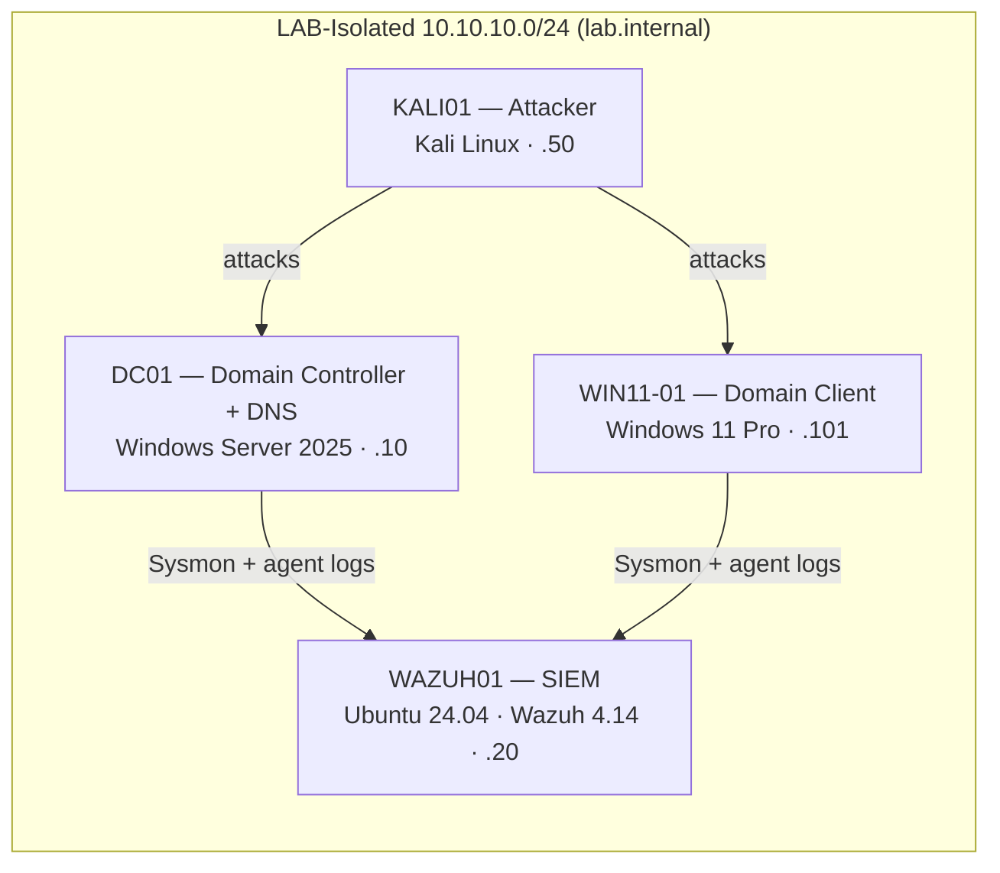
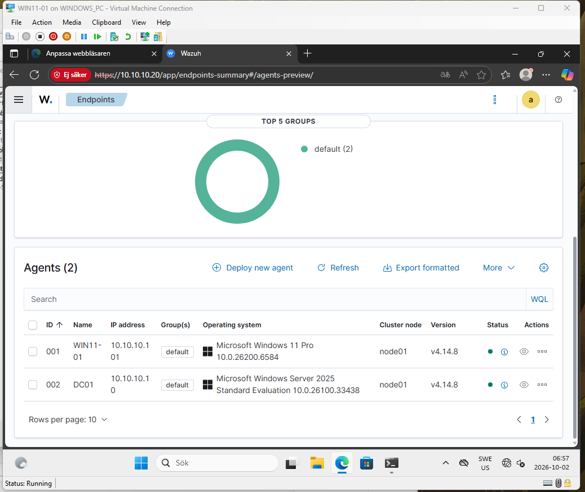
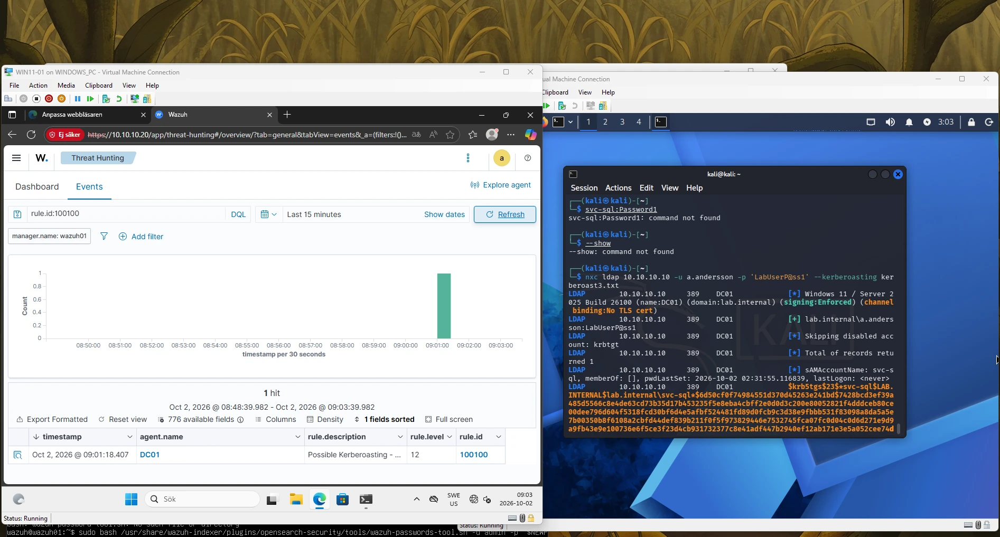
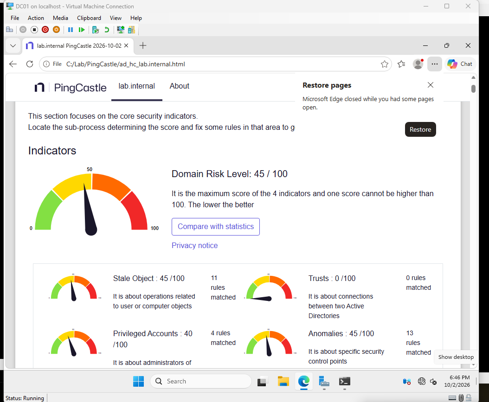
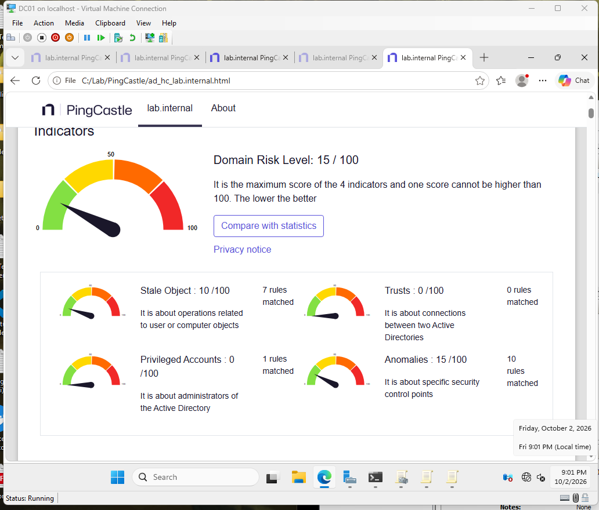

# AD + Wazuh SOC Lab — Attack, Detect, Harden

A self-built Active Directory environment, monitored with the **Wazuh** SIEM, attacked
from **Kali Linux**, and then hardened — with a detection rule, an incident report, and a
verified fix written up for each technique. Everything is scripted and reproducible.

> Built as a portfolio project by an IT-säkerhetstekniker student (TUC Yrkeshögskola,
> Linköping) preparing for a LIA internship. A Swedish summary is in
> [`docs/sammanfattning.md`](docs/sammanfattning.md).

---

## What this project demonstrates

- **Building and running a Windows AD domain** (Server 2025) with users, groups, OUs and a service account.
- **Deploying a SIEM** (Wazuh all-in-one) with Sysmon + agents on Windows endpoints.
- **Offensive testing** of 4 MITRE ATT&CK techniques from Kali.
- **Detection engineering** — reading telemetry, finding gaps, and writing custom Wazuh rules that fire.
- **Defensive hardening** — remediating each finding and **re-testing to prove** the fix, plus a PingCastle audit that went **45 → 15 / 100**.
- Understanding *where a SIEM is strong, where it is blind, and why.*

---

## Architecture

All VMs run on an **isolated** Hyper-V private switch (`LAB-Isolated`, 10.10.10.0/24) with
no route to the host or the internet — attack traffic never leaves the lab.



| Host | Role | OS | IP |
|------|------|----|----|
| DC01 | Domain Controller + DNS | Windows Server 2025 | 10.10.10.10 |
| WAZUH01 | SIEM (Wazuh all-in-one) | Ubuntu Server 24.04 | 10.10.10.20 |
| WIN11-01 | Domain client | Windows 11 Pro | 10.10.10.101 |
| KALI01 | Attacker | Kali Linux | 10.10.10.50 |



---

## Attacks & detections

For each technique: run the attack, check what the SIEM saw, and (where needed) write a
detection rule. Full write-ups are in [`incident-reports/`](incident-reports/).

| # | Technique (ATT&CK) | Result | Detection |
|---|--------------------|--------|-----------|
| [01](incident-reports/01-network-scan.md) | Network scan — *T1046* | Mapped the DC's services | **Blind spot** — host agents don't see packets |
| [02](incident-reports/02-kerberoasting.md) | Kerberoasting — *T1558.003* | Cracked `svc-sql` offline | Silent by default → **custom rule 100100** |
| [03](incident-reports/03-password-spraying.md) | Password spraying — *T1110.003* | Many failed logons | **Caught out-of-the-box** (rule 60204) |
| [04](incident-reports/04-asrep-roasting.md) | AS-REP roasting — *T1558.004* | Cracked `b.berg` offline | Silent by default → **custom rule 100101** |

Custom detection rules live in [`detection-rules/local_rules.xml`](detection-rules/local_rules.xml).



### The key insight — a detection *spectrum*

| Attack | Telemetry on host? | Default SIEM alert? | What was needed |
|--------|:--:|:--:|--|
| Port scan | No | No | Network IDS / firewall logs |
| Kerberoasting | Yes | **No** | A custom analytic |
| Password spray | Yes | **Yes** | Nothing — works by default |

A SIEM is strongest against noisy authentication abuse, and weakest against quiet,
"looks-normal" abuse or anything that never touches a host log. Knowing which is which is
the core analyst skill this project practises.

---

## Hardening — and proving it works

Each fix was **re-tested** to confirm the attack now fails, then the whole domain was
re-audited with PingCastle. Full detail in [`hardening/01-hardening-summary.md`](hardening/01-hardening-summary.md).

| Attack | After hardening |
|--------|-----------------|
| AS-REP roasting | "No entries found" — pre-auth re-enabled |
| Kerberoasting | Ticket is now AES256, **0 cracked** |
| Password spray | Account **locks after 5 tries** |

**PingCastle Domain Risk: 45 → 15 / 100** (Privileged Accounts 40 → 0). The remaining 15 is
documented as a risk-accepted residual (a single-DC lab limitation + two change-controlled
settings) — because real hardening ends in a documented residual, not a fake zero.

| Before | After |
|--------|-------|
|  |  |

---

## Repository layout

```
scripts/            01–14  reproducible build + hardening (PowerShell / bash)
detection-rules/    custom Wazuh rules (local_rules.xml)
incident-reports/   01–04  one markdown report per attack
hardening/          hardening summary with PingCastle before/after
docs/screenshots/   numbered evidence (README.md is the index)
docs/sammanfattning.md   Swedish summary
```

## How to reproduce

1. Hyper-V host with ~24 GB RAM free. Create the `LAB-Isolated` private switch.
2. Build the VMs with `scripts/01`–`10` (DC + domain, Kali, Win11, Wazuh, Sysmon + agents).
3. Run the attacks from Kali; compare against Wazuh (see each incident report).
4. Apply `scripts/11`–`14` to harden, then re-test and re-scan.

> ⚠️ Lab-only. The weak passwords and deliberate misconfigurations here exist to be
> exploited in an isolated network. Never reuse them anywhere real.

---

*Tools: Hyper-V · Windows Server 2025 · Windows 11 · Ubuntu 24.04 · Wazuh 4.14 · Sysmon ·
Kali Linux · netexec · impacket · John the Ripper · PingCastle · MITRE ATT&CK*

---

## Author

**Iaromir Makrushin** — IT-säkerhetstekniker student (TUC Yrkeshögskola, Linköping), seeking a LIA internship.

- LinkedIn: [iaromir-makrushin](https://www.linkedin.com/in/iaromir-makrushin-a285543a9/)

